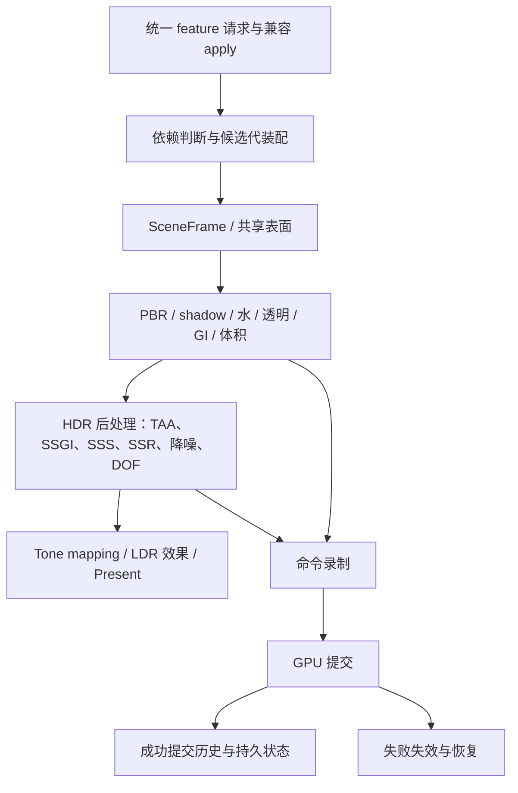

# 46 项渲染功能：逻辑与结构全量复查

**结论：当前候选仍不满足原 planning 的完整交付要求。问题集中在共享状态、成功帧提交、信号分离和主流程接入，不能只逐个修 shader 或增加单项 PASS。**

本轮从 46 项的输入、消费者、资源 owner、控制入口、帧提交及组合约束重新梳理。新增真实 GL 反例确认 **3 个缺陷**：多材质使关闭的直射光重新生效、DDGI 失败恢复漏初始化、VCT 失败恢复漏更新。另列静态确定的接线/合同问题和已披露近似；这些分类不混算为“全部实际复现”。前几轮的 5 个确定缺陷及 1 个已知限制仍保留。

审查对象为 `D:/project/Java/learnopengl-worktrees/integration2`，分支 `codex/render-roadmap-integration-lf`，HEAD `e3bb38d0f7ade59886f12bfe91780307e34ae799`，构建版本 `0.28.0`。主目录 `new-engine` 的 `b9911aeb` 不是本轮交付实现。交付 worktree 审查前后均无 tracked/untracked 改动；生产代码和正式测试未修改。临时探查只在 `build/`，本报告写入主目录。

依据是用户指定的 [46 项 planning](../planning/haikalat-multi-agent-full-delivery.md) 的验收要求；没有执行其中的开发调度或多 agent 指令。本文的“未发现新增问题”只表示本次有界审查未确认问题，不表示重新签收通过。

## 1. 结构判断

现有职责分层本身可以保留：配置/依赖判断、候选代装配、共享表面、功能 owner、后处理已基本分开。问题主要发生在它们之间的合同，而不是缺少更多 manager。



图示是职责关系，具体顺序随配置变化。当前三个最值得优先修复的共性问题：

1. **状态有多个写入者。** 材质默认值与帧开关冲突；统一提交与直接 apply 的阴影失效行为不同。
2. **录制成功被当作帧成功。** Planar、DDGI、VCT 的持久状态提前发布，但统一失败处理漏掉这些 owner。
3. **“颜色纹理”缺少贡献语义。** 接触阴影乘整个颜色，SSS 扩散整个颜色，降噪接收整个合成颜色；深度/法线格式相同并不意味着信号可以任意混用。

另有主流程接入断点：水折射和时域放大有独立实现，但普通 `RenderPipeline` 不能形成启用后的完整路径。局部探针与 VCT 场景输入则是明确需要调用方维护的接口，应与自动场景能力区分。

## 2. 本轮新增、已运行反例的缺陷

### S1 / P1：切换 PBR 材质会恢复已关闭的光照

代码链：[`PbrMaterials.baseBuilder`:485][pbr] 把 `uEnableDirect/uEnableDiffuseIbl/uEnableSpecularIbl` 默认设为 1；[`FrameLightBinder`:149][lightbinder] 再写帧开关；[`SceneRenderer`:144][renderer] 只在 shader 改变或材质被认定会覆盖帧状态时重新绑定。然而 [`RenderPipeline`:174、5316][pipeline] 的帧 uniform 集合没有这三个名字。相同 shader 下切换有 override 的材质实例，或切换材质模板，会再次写默认值，却可能不重新应用帧开关。

反例沿用正式 Clearcoat GL 场景，增加第二个同 shader 的 PBR 实例，带粗糙度 override，并让它有可见区域。关闭 direct 和 IBL、发光为 0 后，比较主光强度 `2.5 → 0` 的完整线性 HDR 图像。独立不变量是：直射光关闭时，图像不能依赖直射光强度。

```text
PBR direct-off source change: changedPixels=10160 maxDifference=0.48095703
expected changedPixels=0
```

这是整个 PBR 消费链的状态缺陷，不是 Clearcoat BRDF 本身的数学错误。影响 #8/#16/#17/#18/#19/#31/#32 等共享材质路径；#7/#10 的光照消费者也需纳入回归。**本轮像素反例验证的是 direct 开关；IBL 的同类风险来自相同静态路径，没有另跑 IBL 反例。**

修复应让材质覆盖检测与实际 frame-owned uniforms 一致，避免依靠“第一笔 draw 会绑定”的偶然条件。回归至少包括同 shader 多材质、instance override、普通/清漆材质切换，以及关闭 direct/IBL 的输入不变性。

### S2 / P1：DDGI 首次 GPU 提交失败后，未初始化探针被当成可用历史

[`DdgiProbeVolume`:289–336][ddgi] 在 record 时推进预算 cursor、设置 `initialized=true` 并交换 irradiance read/write；[`RenderPipeline`:3450][pipeline] 的失败回调没有 DDGI。第一份初始化命令尚未执行，下一帧就跳过全 atlas 初始化，并更新下一个探针。

反例通过真实 pipeline 开启 8 个探针、每帧预算 1；把深度 atlas 预填为确定的 `0.25` 哨兵值，避免依赖驱动未初始化内存。包装设备在相关命令录制完成、真实 GPU execute 之前抛错，再执行一个正常恢复帧。首次成功帧必须把未更新探针初始化为“无表面”深度 1。

```text
DDGI failedProbe=0 recoveryProbe=1 unscheduledDepth=0.25000003
expected unscheduledDepth=1.0
```

哨兵值仍存在，证明初始化确实被漏掉。这里证明的是初始化/恢复错误，不把哨兵对应的任意画面说成常规场景的稳定视觉结果。

修复应区分本帧供下游使用的 pending atlas 与已成功提交状态；首帧失败后重新初始化，部分执行失败后明确失效/重建策略，预算游标与 atlas 交换一起处理。

### S3 / P1：VCT 未提交的体素版本被标为完成，恢复帧直接跳过

[`VctPass`:266][vct] 在 record 时设置 `volumeValid=true`、保存 scene revision；[`RenderPipeline`:4123][pipeline] 同时清空 dirty boxes，失败回调没有撤销或失效。版本没有再变化时，恢复帧计划为空。

反例通过真实 pipeline 提交一个带辐射的 box 三角形快照，在体素命令实际 execute 前抛错，然后正常执行同版本恢复帧：

```text
VCT prematureValid=true
recovery=UpdateStats[full=false, regions=0, baseVoxels=0, mipVoxels=0,
                    dispatches=0, triangles=0, noOp=true]
expected recovery.dispatches > 0
```

这是确定的更新丢失；没有把未写入体素纹理的任意内容作为像素真值。修复需要把 revision/dirty 消费纳入成功帧提交，失败时强制重建必要区域；不能只把统计量改成正确数字。

## 3. 静态确定的接线与合同问题

### S4 / P2：#11 水折射没有接入主场景水面

[`PipelineGeneration`:523][generation] 构造 `WaterSurfacePass(sampleCount)`，没有启用 refraction-support 变体；[`RenderPipeline.waterExecutor`:4001][pipeline] 调用的重载最终传入 `WaterRefractionSettings.disabled()`，见 [`WaterSurfacePass`:163、182][water]。主 pipeline 没有相应折射配置和背景快照装配入口。

独立 pass 和接受 refraction 参数的 API 确实存在，不能说算法未实现。但“单项 pass 测过”不能证明普通水面开启了 #11；#14 与 #30 的水面反射成功也不能替代折射接线。需接入配置、独立背景副本、颜色/深度依赖和消费者验证，再签收水域组合。

### S5 / P2：#35 时域放大只有显式外部 source 路径，主 pipeline 无法启用

[`PipelineGeneration.assemblePostProcess`:240–255][generation] 在首次装配和替换装配中均把 `TemporalUpscalingSource` 传为 null；[`PostProcessPipeline`:494–510][post] 则在时域放大 active 且 source 为 null 时明确抛错。当前 `RenderPipeline` 没有把低分辨率颜色/depth source 送进去的入口。

独立 `PostProcessPipeline` 的外部输入模式有实现，并非将 TAA 改名。问题是主场景的低分辨率生产者、输出分辨率和重建消费者没有闭环。不能把 standalone 的 PASS 写成主 pipeline 已交付，也不能简单删除 source 校验让开关“成功”。

### S6 / P1（合同缺口，已披露近似）：#32/#33 没有真正隔离散射与高光

[`subsurface-scattering.frag`:86、93、168–183][sss-shader] 对最终 `uColor` 做扩散，只用亮度区间 `[2,8]` 降低高光扩散。输入没有 diffuse/scattering 与 specular 的独立分量。因此低亮度镜面项和发光也能被扩散，高亮度漫反射反而可能被保护。

这违反原 planning “直接光/高光分离”“不模糊高光”的最小合同。技术卡 [明确限制第 1/5 项][sss-card] 已披露 whole-HDR 近似，故不是未披露的新发现；但披露不等于完成原合同。现有高亮 patch 测试只证明该亮度启发式有效，无法证明高光分离。

应先确定参与扩散的真实贡献及回合成方式，再补“相同亮度、不同贡献来源”的对照。无需拆出第二套 SSS owner，也无需据此扩张为完整光谱/体积算法。

### S7 / P2：#34 的实际信号是 SSR 后的整幅颜色，主流程仅使用相机重投影

[`ssr.frag` 末尾][ssr-shader] 输出 `base + weight * (hitRadiance - environmentRadiance)`；[`PostProcessPipeline`:1235–1272][post] 把该完整 HDR 颜色送入降噪，而不是单独的反射贡献，同时将 velocity 和 previous-depth 两个输入都传 0。

所以它会滤波已有直射、IBL、发光等合成内容，并不能利用已存在的物体 velocity 跟随物体。深度/法线拒绝可以减少错误，但无法识别“同深度同法线的横向纹理运动”。[`TemporalDenoiseInputs`][denoise-input] 本身已有 velocity 模式；缺口发生在主消费者接线。

这是当前实现的**信号范围与动态支持限制**，本轮未新增运动鬼影像素反例。要按原 planning 签收真实信号降噪，需明确反射贡献/置信度、对应运动信息和回合成，不应把“SSR pass 存在”当作信号隔离证明。

### S8 / P1：#20/#41 的 SSR 射线投影与采样深度的 jitter 空间不一致（静态确认）

[`PostProcessPipeline`:1228–1229][post] 传入 `inverseJitteredProjection` 用于深度重建，却传入 `stableViewProjection` 用于投射射线样本；[`ssr.frag`:97–114、200–207][ssr-shader] 直接用投射结果查当前 raster depth，没有加当前 jitter。自适应 SSR shader 使用同类投影合同。

一个从 jittered 深度坐标 `uv` 重建的同一世界点，用 stable VP 投回会落在 `uv - jitter`，而不是原来的 depth texel。因此非零 TAA jitter 下，命中检测/细化会查询错位深度；薄边和遮挡边界是敏感位置。无 jitter 的 SSR 正式测试不能排除此问题。

这是具体的矩阵/采样合同矛盾，**本轮未执行对应 SSR 图像反例**，不量化其视觉严重程度。修复可统一为 raster 投影，或明确补偿 projected UV，并同时覆盖固定步数和自适应路径。

特别核查了一个相似疑点：当前 `taa-resolve.frag:54` 仍以当前 `rasterUv` 写颜色，不能仅凭“TAA 之后”就断言所有颜色已移到 stable 栅格。本轮不据此误报 SSGI、motion blur 都有同样错位；先前 SSGI jitter 修复结论保留。

## 4. 需要保留的边界与组合风险

以下不是本轮新增 GL 缺陷，不能与 S1–S3 混计：

- **C1：局部探针由调用方绑定。** `PbrMaterials.bindReflectionProbes(instance, set, worldPosition)` 做选择、混合和 uniform 更新，但 main/demo 中检索只有声明，普通场景没有自动逐 receiver 调用。显式 API 可以使用；移动 receiver 的刷新与实例隔离由应用负责。应补真实调用示例及移动/区域边界组合，不能声称自动接管所有 PBR receiver。
- **C2：GI 接收材质被简化。** DDGI shader 使用场景统一 albedo；VCT 使用统一 albedo/roughness 与深度导数法线，没有逐像素材质接收标记。相关 shader 已公开这些近似。普通混合材质场景的金属、黑色漫反射、unlit 不能按真实材质语义区分，且同已有 IBL 的能量关系需要说明。算法有效不等于通用 PBR GI；这是应明确限制或收口的合同，非本轮逐材质像素复现。
- **C3：透明集合不是一个全局排序问题的完整解。** #26 只排自身 GPU 粒子；#28/#37 有各自集合与互斥/重叠限制；水/玻璃在独立阶段。不能把三个 pass 依次存在解释为任意透明物体交错正确。当前随机透明已排除 TAA，这一显式限制应保留，不能反过来报告它接受 TAA 却失配。
- **C4：后处理深度不包含所有颜色层。** DOF/motion blur 等消费共享 opaque surface，而输入颜色可能已有玻璃、水、VFX/体积。透明覆盖不会自动获得正确景深和 velocity。原计划要求的透明覆盖、VFX 策略应通过组合场景明确；本轮不把缺少透明 G-buffer 自动升级成必须重写 deferred renderer。
- **C5：多个介质顺序合成是近似。** 雾、局部体积粒子、云、烟分别积分并依次合成，可以证明每个介质只计算一次，却不能证明空间重叠时的联合散射/遮挡正确。不同介质颜色时，合成顺序一般不可交换。需要明确允许的空间关系与非零介质交互参考；本轮没有新增体积像素反例，不直接认定所有支持场景都错误。
- **C6：部分颜色依赖靠声明顺序与别名维持。** 如 stochastic 后没有更新局部 `sceneColorProducer`，cloud 仍依赖前一个 producer；当前附件共享和编译器声明顺序可能维持实际执行，不能据此声称已经丢颜色。但 graph 边没有完整描述语义依赖，重排/维护易破坏。应让最后写入者与后续依赖一致，再用明确次序断言验证。
- **C7：VCT 输入是调用方转换的三角形快照。** 主 pipeline 不自动把 `Scene`、形变和材质转换成该快照，输入为空时 executor 返回。应明确 caller 的 revision/dirty 责任，并让诊断区分“配置开启”和“已有可用场景输入”。不把已有真实三角形体素化说成仅 AABB 原型。

## 5. 前几轮问题合并保留

当前候选没有改变，以下复用已归档证据，本轮没有重复运行：

| ID | 分类 | 仍存在的问题 | 已有证据 |
|---|---|---|---|
| T1 | P1，确定缺陷 | #9 将整个颜色乘暗；direct-on 时 unlit 也被压暗 | 亮度 `0.17152537 → 0.046492055` |
| T2 | P1，确定缺陷 | #46 投影持续开启，统一提交只改变发束长度不刷新静态阴影 | `rendered=0/reused=1`；与等价 apply 相差 3,000 接收面像素 |
| L1 | P2，确定缺陷 | #9 批量“暂停+开启 contact”后恢复，effective 已开启但 pass 缺失 | master/direct/contact 均 true，`hasPass=false` |
| L2 | P2，确定缺陷 | #46 新代发布后旧代退役失败，跳过发束阴影失效 | 应刷新 1 tile，实际 0 |
| L3 | P1，确定缺陷 | #30 record 提前设 valid/节流，GPU 提交失败后恢复仍跳过 | 失败后 valid=true，恢复 updateCount 仍 1 |
| L4 | P2，已披露限制 | #30 更新间隔大于 1 时相机突变不打断节流 | 正式 fixture 改间隔 3 后原刷新断言失败 |

详情见 [第三次验收](2026-11-13-render-roadmap-third-acceptance.md) 和 [逻辑复查报告](2026-11-13-render-roadmap-logic-review.md)。T1 与 S6/S7 都提示贡献信号缺少隔离；L3 与 S2/S3 则是同类帧事务问题，建议一起治理。

## 6. 46 项逐项逻辑结构表

“未确认新增”不是完整验收 PASS；已有测试支持范围、交互缺证和上述共享缺陷仍有效。表中的入口是当前代码归属，不要求每个材质功能都新增独立 feature switch。

| # | 功能 | 输入 → 生产消费者 / owner | 本轮结构判断 |
|---|---|---|---|
| 1 | Fresnel / Rim | MeshVfx NORMAL、变换、视线 → VfxRenderer / vfx shader | 法线矩阵及有 NORMAL 门控明确；仅 MeshVfx 范围，未确认新增局部问题。 |
| 2 | UV Flow / Distortion | 固定种子、effect time、图集区域 → VfxRenderer / texture sampling | 时间输入明确；flipbook 通过 base LOD 与半 texel 限制串格，这是质量取舍，不能泛称完整 mip 图集解。未确认新增。 |
| 3 | Dissolve / Erosion | 生命周期/显式进度、noise、edge → VFX color/reactive | 端点与 primitive 类型解耦明确；既有动态 TAA 证据保留，未确认新增。 |
| 4 | Screen-Space Distortion | 有界贡献、背景 HDR/depth → ScreenDistortionPass → 新附件 | 有独立读写目标及排序输入；多透明/时域组合仍缺证，未确认新增反馈循环。 |
| 5 | Vertex Displacement | 有界局部模型、显式时间 → DrawBinding → forward/depth/shadow/velocity | 有 previous/pending 成功帧提交，模型编辑失效；保留形变顺序与 bounds 限制。未确认新增；不因接口支持就宣称所有 skin/morph 组合已测。 |
| 6 | Projected Decals | 投影体积、scene depth → VfxRenderer 的 projected decal 路径 | 真实深度重建；薄墙/移动/resize 既有补证保留。宿主透明/扭曲组合仍待补。 |
| 7 | VFX Dynamic Lighting | 冻结 VfxLight → VfxLightBridge → FrameLightTable → PBR | 身份/容量/取消与灯表职责清楚；消费者受 S1 帧开关缺陷影响。 |
| 8 | Thin Translucency | PBR thickness/transmission/backlight → PBR direct BRDF | 局部输入与双面语义已有；受 S1；MASK caster/阴影联合证据及自遮挡限制仍保留。 |
| 9 | Contact Shadows | 场景 depth → 屏幕空间 occlusion → 全色乘法 | T1 信号作用域错误、L1 暂停恢复拓扑错误。不是仅缺测试。 |
| 10 | Cloud Shadows | 世界投影、主光方向、滚动时间 → PBR directional visibility | 调制在直射项中，局部结构合理；受 S1 共享开关问题，云层联合场景范围需保留。 |
| 11 | Water Refraction | 受控背景副本/depth → 可选 WaterSurfacePass 变体 | S4：独立实现存在，主场景重载固定 disabled。 |
| 12 | DOF | HDR + opaque depth、物理焦点/焦距 → 有界 CoC gather | 有前景扩散与拒绝分支；C4 透明覆盖仍是边界，不把 opaque-only 证据扩展为任意透明。 |
| 13 | Refraction | 材质 IOR/thickness → 独立背景 copy → RefractionPass | 从普通 forward 队列排除、单层背景快照避免反馈；多层玻璃/跨透明集合限制明确，水域组合待补。 |
| 14 | Water Surface | 有限区域、时间、波动、depth → WaterSurfacePass | 主入口存在，#30 已接入；#11 不随之启用。关联 L3/L4 反射有效性/节流。 |
| 15 | Particle Collision | 场景 depth、VP、厚度/步长 → GPU particle compute | 算法/owner 有输入校验；GpuParticleVfx 的真实开启碰撞消费者证据仍欠缺，C3/C4。 |
| 16 | Clearcoat | PBR coat roughness/normal → layered BRDF/IBL | S1 已用该消费者复现多材质开关错误；单材质 BRDF 参考不能覆盖它。 |
| 17 | Anisotropic | tangent/handedness、旋转/strength → PBR lobe | 退化切线回退和零值路径可见；IBL 是公开近似。受 S1，不将近似本身当新增 bug。 |
| 18 | Local Reflection Probes | 预计算 cubemap/影响区、receiver 位置 → 显式 binder → PBR | C1：需要 caller 更新选择；没有普通 Scene 自动绑定。受 S1；不能声称完全未实现。 |
| 19 | PCSS | shadow atlas/blocker、世界尺度、预算 → directional shadow sampler | 使用既有图集与有界 taps；受 S1 光照状态影响，位移/材质交互证据待补。 |
| 20 | SSR | HDR、depth/normal/roughness、环境 → SsrPass | S8：TAA 下 raster/stable 投影混用；输出是合成颜色，影响 #34 的信号合同。 |
| 21 | Motion Blur | 当前颜色、stable velocity、validity → 有界 gather | 无效运动/切镜走 identity；当前 TAA 颜色仍 raster-indexed，不误报全局错位。C4 无 velocity 层仍须明确。 |
| 22 | SMAA | LDR colour → edge → weights/LUT → neighborhood | 三阶段及边图清零明确，AA 模式独立；既有来源/许可证据保留，未确认新增。 |
| 23 | Vignette | LDR colour、宽高比/强度 → 镜头效果 pass | 强度零值与 aspect 处理明确，位于 UI 前的宿主合同仍需组合证据；未确认新增。 |
| 24 | Film Grain | LDR colour、seed/亮度响应 → grain pass | TAA 后，无私有 history；固定种子可重现。未确认新增；动画时间由调用者合同决定。 |
| 25 | Chromatic Aberration | LDR colour、强度/半径/有界 taps → RGB 分采样 | UV clamp/中心方向为零；未确认新增；UI 组合证据不等于 shader 单项数值。 |
| 26 | GPU Particle Sorting | active indices、view depth → GPU sort → indirect draw | 确有实际消费，不只是算键；只保证自身集合，不能代替 C3 全局透明排序。 |
| 27 | GPU Particle Indirect | 有界 emission/life → compute/reset/barrier → indirect command | 无逐帧 CPU 活跃数读回决策；adapter 以 recorded 为统计语义，失败/暂停等宿主消费者证据仍有限。 |
| 28 | Weighted Blended OIT | 显式透明集合 → accumulation/revealage → resolve | 与普通队列分离并有集合声明；是近似策略，不是精确折射；C3。 |
| 29 | Atmospheric Scattering | 物理单位/太阳参数 → transmittance/sky-view LUT → sky | 独立天空 owner，LUT barrier 明确；未确认新增。联合雾不能仅凭各项单测签收。 |
| 30 | Planar Reflections | 镜像相机/裁剪 + 主场景队列 → reflection target → water | L3 提交失败有效性错误；L4 节流切镜限制；主视图集合不等于完整镜像视锥集合。 |
| 31 | POM | tangent-space height/UV → PBR UV march | 不改实际轮廓/depth/shadow，是已说明近似；受 S1；不与 #5 位移混同。 |
| 32 | SSS 材质 | profile/厚度/半径 → 前向透射 + shared SUBSURFACE | 有材质语义和共享输入；S6 未把实际散射分量独立提供给屏幕扩散，受 S1。 |
| 33 | Screen-Space SSS | HDR + depth/normal/subsurface mask → diffusion | S6：亮度保护不能证明不模糊镜面项。与 #32 共用 owner 方向正确，无需为计数重复实现。 |
| 34 | Temporal Denoising | SSR 后 HDR/depth/normal → history/filter | S7：整色信号、主流程 camera-only；需明确物体运动与真实反射信号的支持范围。 |
| 35 | Temporal Upscaling | 外部低分辨率 source → 独立重建/history/sharpen | S5：主 RenderPipeline 始终传 null，启用被拒；standalone 能力与场景整合分开。 |
| 36 | Caustics | 水域/主光方向/时间 + depth → 艺术焦散合成 | 区域/水域拒绝与采样预算明确；保留艺术近似定位，复杂接收面/透明水域交互待补。 |
| 37 | Stochastic Transparency | 独立透明集合、seed、depth → coverage/history | 有成功/失败回调，TAA 组合显式不可用；C3/C6，不能用默认 pass 次序替代交错正确性。 |
| 38 | Volumetric Particles | 有限解析密度体、opaque depth → 有界 raymarch/composite | owner/覆盖率上限明确；C5 多介质空间重叠仍不能从“各积分一次”推出正确。 |
| 39 | SSGI | radiance + shared albedo/normal/roughness/velocity/validity → GI history | 成功帧 jitter/历史修复保留，不重新打开旧缺陷；同其他 GI/IBL 的贡献关系及组合仍待补。 |
| 40 | Volumetric Clouds | 云层密度、太阳/云影参数 → 低分辨率体积 + history/composite | 有成功/失败 history 回调；C5/C6。正常历史与边界证据保留，性能无新结论。 |
| 41 | Adaptive Sampling | SSR 屏幕误差估计 → 有界 ray budget | 有真实 SSR 消费者，不是质量档改名；继承 S8 的投影问题。预算/residual 证据不自动等于速度收益。 |
| 42 | VRS | 精确 NV capability + rate image → 声明的 SSS draw scope | begin/end 状态范围、候选 resize 与回退明确；不是整个 renderer 的通用 VRS。保留既有 NV 功能证据，消费者 S6 仍需修复。 |
| 43 | Volumetric Smoke | 固定步长/注入 → GPU density simulation → volume renderer | simulation/render owner 分开，pipeline 失败后设置 reset pending；没有把它误并入 S2/S3。C5/暂停重放组合待补。 |
| 44 | DDGI | SceneFrame caster raster → 分预算探针更新 → 间接光 composite | S2：首帧失败状态提交错误；C2 材质近似。存在动态更新，不能称静态烘焙。 |
| 45 | VCT | caller 三角形/radiance snapshot → voxel/mip → cone/composite | S3：失败丢版本更新；C2/C7 接收材质及场景同步边界。 |
| 46 | Hair Strands | 确定性 strand 数据/LOD → shading + shadow recorder | 有真实 strand 路径；T2/L2 阴影失效/发布异常错误仍阻塞。 |

## 7. 修复和验收顺序

1. **先修共享正确性：** S1 的材质/帧状态写入合同；T2/L2 的阴影失效与发布顺序；L3/S2/S3 的成功帧提交和失败失效。这些问题会让单项静态场景通过而正常编辑/异常恢复失败。
2. **明确贡献信号与坐标：** T1、S6、S7、S8。先确定每个 pass 修改哪一份贡献、读哪一套 raster 数据，再添加相应测试；不要靠亮度阈值或关闭整个功能掩盖错误。
3. **补主场景闭环：** S4/S5，明确 C1/C7 的 caller 责任与 unavailable 诊断。独立 API 可以继续保留，不必为每项增加一个新管理器。
4. **补原计划代表交互：** 多材质灯控、jitter SSR、失败恢复、折射水域、透明/粒子、非零多介质、动态 GI、UI 与镜头链。沿用有意义的事件序列，不跑 46 开关全排列。

S6 现有 7 个子组合没有覆盖所有原计划交互；正式 `S6InteractionMatrixGlTest:625–630` 的 `A < B || B < A` 不能证明正确次序。应换成具体合同的依赖与像素/数值断言，不能用新增测试数代替行为证据。

## 8. 执行证据与限制

新证据目录：[structure-review-20261113-e3bb38d0][evidence]，含 `probe-src/`、生成脚本、init script、日志、两次 JUnit 归档、case-summary、HEAD 和工作树身份。

```powershell
.\gradlew.bat -I build/reports/render-roadmap/structure-review-20261113-e3bb38d0/probes.init.gradle glSmoke --tests '*GiSubmissionStructureGlTest.vctFailedSubmissionMustRetryTheUnsubmittedRevision' --tests '*GiSubmissionStructureGlTest.ddgiFailedFirstSubmissionMustInitializeUnscheduledDepth' --tests '*PbrFrameGateStructureGlTest.clearcoatMatchesIndependentDirectAndIblReferencesAndRestoresExactly' --console=plain

# 加强 PBR oracle 后，只执行对应事件用例
.\gradlew.bat -I build/reports/render-roadmap/structure-review-20261113-e3bb38d0/probes.init.gradle glSmoke --tests '*PbrFrameGateStructureGlTest.clearcoatMatchesIndependentDirectAndIblReferencesAndRestoresExactly' --console=plain
```

- 初次临时 probe 写错 getter `ddgi()`，在 compileTestJava 停止，0 用例执行；修正为真实 API `ddgiVolume()`。保留 `harness-compile.log`，不计产品故障。
- 第一轮实际运行 3 个 case：DDGI、VCT 断言失败；PBR 中央区域采样通过。中央区域不足以排除第二材质的问题，因此没有据其宣称多材质通过。
- 第二轮改用完整图像在 direct-off 时对入射光强度不变的 oracle，仅运行 PBR 一项，断言失败。不是原失败盲目重试。最终源码保留在 probe-src，初版由 create-probes.ps1 可还原。
- 合计 **4 次实际 case 执行，1 次通过、3 次预期合同断言失败，0 error/skip**；PBR 两次是不同 probe 版本，不算两个独立功能。第一轮 Gradle 17 秒；新生产代码编译等多数为 UP-TO-DATE，probe 编译与 GL 用例为新执行。
- 第三次验收的 75 个通过/2 个反例失败，随后逻辑审查的 4 个反例，以及归档 1,342 个通过证据，本轮仅引用，不称为新执行。
- 未执行完整 46 项 GL 矩阵、benchmark、长测或发布矩阵；未对 S8 新跑 jitter SSR 图像反例，也未逐个复现 C1–C7。缺证不等于确定 bug，技术卡限制不等于原合同自动获准缩减。

[pipeline]: D:/project/Java/learnopengl-worktrees/integration2/src/main/java/com/kaleblangley/haikalat/subsystems/render3d/RenderPipeline.java
[pbr]: D:/project/Java/learnopengl-worktrees/integration2/src/main/java/com/kaleblangley/haikalat/subsystems/render3d/pbr/PbrMaterials.java:485
[lightbinder]: D:/project/Java/learnopengl-worktrees/integration2/src/main/java/com/kaleblangley/haikalat/subsystems/render3d/lighting/FrameLightBinder.java:149
[renderer]: D:/project/Java/learnopengl-worktrees/integration2/src/main/java/com/kaleblangley/haikalat/subsystems/render3d/geometry/SceneRenderer.java:144
[ddgi]: D:/project/Java/learnopengl-worktrees/integration2/src/main/java/com/kaleblangley/haikalat/subsystems/render3d/ddgi/DdgiProbeVolume.java:289
[vct]: D:/project/Java/learnopengl-worktrees/integration2/src/main/java/com/kaleblangley/haikalat/subsystems/render3d/vct/VctPass.java:266
[generation]: D:/project/Java/learnopengl-worktrees/integration2/src/main/java/com/kaleblangley/haikalat/subsystems/render3d/pipeline/PipelineGeneration.java:240
[water]: D:/project/Java/learnopengl-worktrees/integration2/src/main/java/com/kaleblangley/haikalat/subsystems/render3d/water/WaterSurfacePass.java:163
[post]: D:/project/Java/learnopengl-worktrees/integration2/src/main/java/com/kaleblangley/haikalat/subsystems/postprocess/PostProcessPipeline.java
[sss-shader]: D:/project/Java/learnopengl-worktrees/integration2/src/main/resources/shaders/postprocess/subsurface-scattering.frag:86
[sss-card]: D:/project/Java/learnopengl-worktrees/integration2/docs/planning/v0.28.1-s4-sss.md:218
[ssr-shader]: D:/project/Java/learnopengl-worktrees/integration2/src/main/resources/shaders/postprocess/ssr.frag:97
[denoise-input]: D:/project/Java/learnopengl-worktrees/integration2/src/main/java/com/kaleblangley/haikalat/subsystems/postprocess/denoise/TemporalDenoiseInputs.java
[evidence]: D:/project/Java/learnopengl-worktrees/integration2/build/reports/render-roadmap/structure-review-20261113-e3bb38d0
